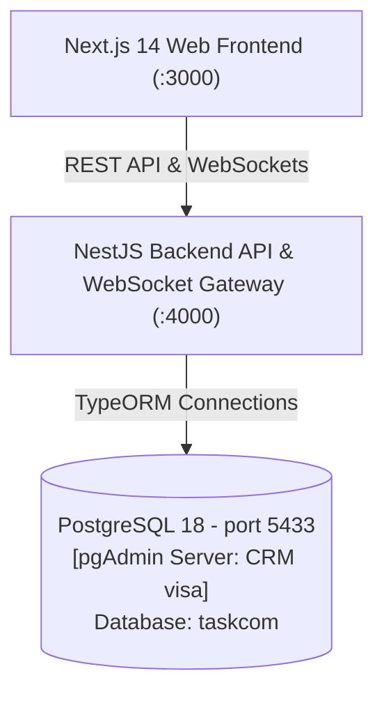

# Communication & Task Management Platform (TaskCom)

A modern, production-ready enterprise team communication and task management platform featuring:
- **Frontend**: **Next.js 14** (App Router, React 18, Tailwind CSS, Lucide icons, Zustand state management, Socket.io client).
- **Backend**: **NestJS** with **TypeORM**, JWT authentication, role-based access control, WebSocket gateway, and file storage.
- **Database**: **PostgreSQL** running on port `5433` (pgAdmin server: **CRM visa**, Database: **taskcom**).
- **Testing**: Unit tests and multi-tenant security isolation tests for both backend and frontend.

---

## 🏗 System Architecture



### Key Modules:
- **Authentication & Security**: Multi-tenant resolution, rotating refresh tokens, Bcrypt hashing, AES-256-GCM encryption, Role guards (`OWNER`, `ADMIN`, `MANAGER`, `MEMBER`).
- **Chat & Messaging**: WhatsApp-style direct messages, department channels (`#administration`, `#hr`, `#accounts`, `#it`, `#marketing`, `#sales`), typing indicators, online presence, attachments, and 1-click converting messages into tasks.
- **Task Management**: Kanban board & list view, status transitions (`To Do`, `In Progress`, `Under Review`, `Done`, `Cancelled`, `On Hold`), priority indicators (`URGENT`, `HIGH`, `MEDIUM`, `LOW`), checklists, deadline extension requests, activity audit logs, and real-time task comments.
- **Organization & Admin**: Branches (Islamabad Head Office, Lahore, Karachi), departments, designations, member invitation management.
- **Analytics & Reports**: Personal & manager dashboards, completion velocity, overdue task tracking, workload distribution, and CSV export.
- **Localization**: Full English (`en`) and Urdu (`ur`) internationalization with RTL support.

---

## 🗄 Database Configuration

| Setting | Value |
|---|---|
| **pgAdmin Server** | `CRM visa` |
| **Host** | `127.0.0.1` / `localhost` |
| **Port** | `5433` |
| **User** | `postgres` |
| **Password** | `root` |
| **Database Name** | `taskcom` |

---

## 🚀 Getting Started

### 1. Prerequisites
- **Node.js**: v18+ (tested on Node v24)
- **pnpm**: v9+ (or v12)
- **PostgreSQL**: Running on port `5433` with database `taskcom`

### 2. Environment Setup
The `.env` file at the root (and in `apps/api/.env`) is pre-configured for `taskcom`:
```env
PORT=4000
API_URL=http://localhost:4000
WEB_URL=http://localhost:3000

DB_HOST=127.0.0.1
DB_PORT=5433
DB_USER=postgres
DB_PASSWORD=root
DB_CONTROL_NAME=taskcom
DB_NAME=taskcom
DEFAULT_TENANT_SUBDOMAIN=taskcom
```

### 3. Seed Database
To populate `taskcom` with departments, branches, designations, Pakistani corporate demo accounts, conversations, and tasks:
```bash
pnpm seed
```

### 4. Run Development Servers
Start both the NestJS API (`http://localhost:4000`) and Next.js frontend (`http://localhost:3000`) simultaneously:
```bash
pnpm dev
```
Or start them individually:
```bash
pnpm dev:api   # Starts NestJS backend
pnpm dev:web   # Starts Next.js frontend
```

### 5. Production Build
```bash
pnpm build
```

---

## 🧪 Testing

Run all unit tests across the backend and frontend:
```bash
pnpm test
```

Run cross-tenant security and isolation test suite:
```bash
pnpm test:isolation
```

---

## 👥 Pre-seeded Demo Accounts

| Role | Name | Email | Password |
|---|---|---|---|
| **CEO / Owner** | Muhammad Tariq | `tariq@acme.com` | `Password123!` |
| **Admin** | Sana Javed | `sana.javed@acme.com` | `Password123!` |
| **HR Director** | Fatima Zahra | `fatima.zahra@acme.com` | `Password123!` |
| **Finance / Accounts Head** | Bilal Ahmed | `bilal.ahmed@acme.com` | `Password123!` |
| **DevOps / IT Lead** | Hamza Ali | `hamza.ali@acme.com` | `Password123!` |
| **Marketing Head** | Ayesha Khan | `ayesha.khan@acme.com` | `Password123!` |
| **Sales Manager** | Kamran Akram | `kamran.akram@acme.com` | `Password123!` |
| **Default Member** | Alice Smith | `alice@acme.com` | `Password123!` |
| **Super Admin** | Master Super Admin | `superadmin@saas.com` | `SuperAdmin123!` |

---

## 📚 API Documentation (Swagger)
When the backend is running, access interactive OpenAPI / Swagger documentation at:
- **URL**: `http://localhost:4000/docs`
